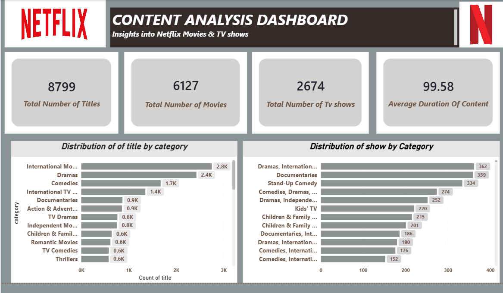

# 🎬 Netflix Content Catalog Analysis – Power BI Part-I

## 📊 Dashboard Preview

## 📥 Download Power BI Project

[⬇️ Download Netflix Power BI Dashboard (.pbix)](<Netflix content analysis dashboard.pbix>)

## 🛠️ Tools & Technologies
- Power BI
- Power Query
- DAX
- Data Cleaning
- Data Modeling

## 📌 Project Overview

This project analyzes Netflix's content catalog to identify trends in movies, TV shows, genres, and content distribution.

## 🔍 Key Analysis
- Movies vs TV Shows Distribution
- Content by Genre
- Content by Country
- Year-wise Content Trends
- Netflix Content Analysis

📊 Netflix Content Analysis Dashboard – Power BI | Part 2

## 📸 Dashboard Preview

## 📥 Download Power BI Project

[⬇️ Download Netflix Power BI Dashboard (.pbix)](Netflix%20content%20analysis%20dashboard%20Part%202.pbix)

🛠️ Tools & Technologies

- Power BI
- Power Query
- DAX
- Data Cleaning
- Data Modeling
- Data Visualization

📌 Project Overview

This project focuses on analyzing Netflix's content catalog to explore Movies, TV Shows, content categories, director-wise ratings, and runtime patterns using Power BI.

🔍 Key Analysis

- Content Type Distribution
- Category Performance
- Rating Count by Director
- Country-wise Content Analysis
- Interactive Country Filtering

🧠 Brainstorming Reflections – Key Insights

1. Which TV Show has the highest runtime in the TV Shows category?

Answer: Grey's Anatomy has the highest runtime among TV Shows in the dataset.

2. What is the runtime of Dramas directed by Christophe Charrier?

Answer: 82 minutes is the runtime of Dramas directed by Christophe Charrier.

💡 Key Learnings

- Improved analytical thinking.
- Practiced data exploration using Power BI.
- Developed interactive dashboards.
- Learned to extract meaningful insights from datasets.

🏁 Conclusion

This project demonstrates how Power BI helps transform raw Netflix data into meaningful insights through interactive dashboards and analytical exploration.

---

Created by Aditya Kumar

